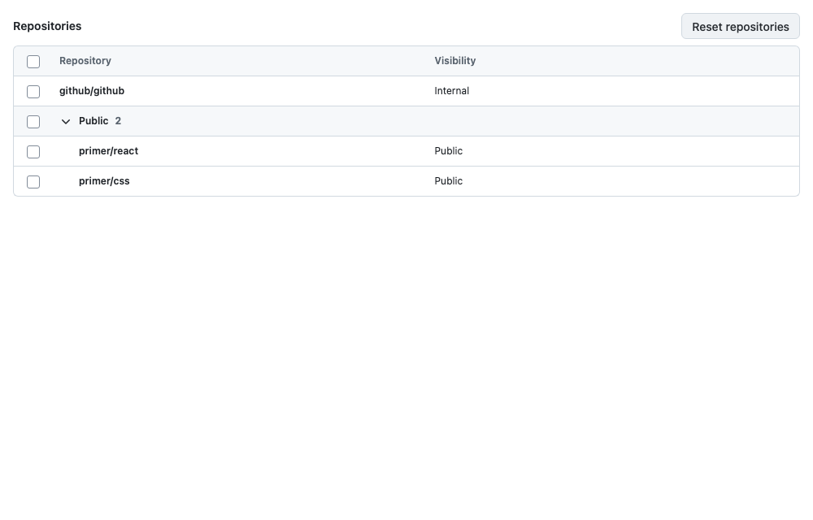
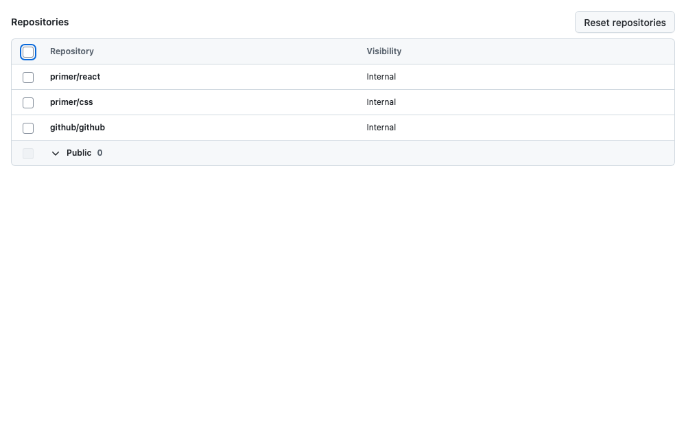

# DataTable selection announcements: Track A evidence

This report accompanies the fixes for [#7342](https://github.com/github/primer/issues/7342), [#7343](https://github.com/github/primer/issues/7343), and [#7344](https://github.com/github/primer/issues/7344). It records browser evidence, **not a manual screen-reader pass**.

- Baseline: `f80b27cc531b4f12f3384a68a6c0259639d07d99`, captured before implementation edits.
- Implementation: [`4e744c114acc2e6d2d445611fa8f293f8ee12875`](https://github.com/primer/react/commit/4e744c114acc2e6d2d445611fa8f293f8ee12875).
- Captured November 5, 2026 in Chromium `148.0.7778.96`, Playwright `1.60.0`, viewport **1000 × 640**, DPR **1**, light theme, default **normal** density, reduced motion.
- Same existing stories, data, actions, and viewport before/after. Neither captured story's fixture was edited. Both group checkbox and disclosure remain present.
- **All eight PNG pairs are byte-identical**: [SHA-256 comparison](./image-comparison.json). The changes affect announcements and accessible structure, so the screenshots are supplemented with accessible-tree and live-region evidence.

## Visual proof

### Inactive toolbar, zero selected after resetting the repositories

| Before                                                                   | After                                                                  |
| ------------------------------------------------------------------------ | ---------------------------------------------------------------------- |
|  |  |

### Keyboard activation clears selection and returns focus to select-all

| Before                                                                   | After                                                                  |
| ------------------------------------------------------------------------ | ---------------------------------------------------------------------- |
|  |  |

### All captured states

| Fixture/state                 | Baseline screenshot                          | Final screenshot                           | Accessible tree before / after                                                                      |
| ----------------------------- | -------------------------------------------- | ------------------------------------------ | --------------------------------------------------------------------------------------------------- |
| Toolbar, preselected mount    | [Before](./before/bulk-preselected.png)      | [After](./after/bulk-preselected.png)      | [Before](./before/bulk-preselected.aria.txt) / [After](./after/bulk-preselected.aria.txt)           |
| Toolbar, zero after reset     | [Before](./before/bulk-zero.png)             | [After](./after/bulk-zero.png)             | [Before](./before/bulk-zero.aria.txt) / [After](./after/bulk-zero.aria.txt)                         |
| Toolbar, one selected         | [Before](./before/bulk-one.png)              | [After](./after/bulk-one.png)              | [Before](./before/bulk-one.aria.txt) / [After](./after/bulk-one.aria.txt)                           |
| Toolbar, multiple selected    | [Before](./before/bulk-multiple.png)         | [After](./after/bulk-multiple.png)         | [Before](./before/bulk-multiple.aria.txt) / [After](./after/bulk-multiple.aria.txt)                 |
| Toolbar, keyboard clear/focus | [Before](./before/bulk-cleared-keyboard.png) | [After](./after/bulk-cleared-keyboard.png) | [Before](./before/bulk-cleared-keyboard.aria.txt) / [After](./after/bulk-cleared-keyboard.aria.txt) |
| No toolbar, preselected mount | [Before](./before/selection-preselected.png) | [After](./after/selection-preselected.png) | [Before](./before/selection-preselected.aria.txt) / [After](./after/selection-preselected.aria.txt) |
| No toolbar, select-all        | [Before](./before/selection-all.png)         | [After](./after/selection-all.png)         | [Before](./before/selection-all.aria.txt) / [After](./after/selection-all.aria.txt)                 |
| No toolbar, cleared           | [Before](./before/selection-cleared.png)     | [After](./after/selection-cleared.png)     | [Before](./before/selection-cleared.aria.txt) / [After](./after/selection-cleared.aria.txt)         |

## Invisible changes

| Observation               | Before                                                                                                          | After                                                                                             |
| ------------------------- | --------------------------------------------------------------------------------------------------------------- | ------------------------------------------------------------------------------------------------- |
| Inactive toolbar          | Extra accessible header `row "0 selected"` and spanning cell; six table rows in the bulk fixture                | Inactive row excluded; five accessible rows                                                       |
| Active toolbar            | Two header rows, preserved column names, actions replace sorting controls                                       | Same structure and visible UI                                                                     |
| Clearing selection        | Focus returns to select-all; inactive accessible row remains                                                    | Focus still returns to select-all; inactive accessible row disappears                             |
| Selection without toolbar | No aggregate live-region requests                                                                               | One request and delivered DOM message per count change, including zero                            |
| Rapid changes             | No explicit toolbar debounce                                                                                    | Canceled superseded requests; final message after 150 ms                                          |
| Initial selection         | Source opts into mount announcement when toolbar starts active; no request observed in these Storybook captures | Explicitly silent, covered by browser component tests with an existing live region and StrictMode |

With the toolbar, the observed final message sequence is `0 selected` → `1 selected` → `2 selected` → `0 selected`. Without a toolbar, selecting all and clearing produce `8 selected` → `0 selected`; the baseline produces neither message. [Before observations](./before/observations.json) and [after observations](./after/observations.json) include requests, delivered shadow-root text, focus HTML, and URLs. Full Chromium accessibility trees are the adjacent `*.ax.json` files.

The 14 new component tests additionally cover zero and preselected initial mounts in both configurations, individual selection/deselection, multiple selections, select-all, clear, localized zero wording, unchanged counts, rapid changes, enabling selection, adding/removing a toolbar, cancellation on unmount, standalone bulk actions, and keyboard focus recovery.

`DataTable` uses the existing `@primer/live-region-element` delivery API directly, anchored to the table. This avoids adding a DOM sibling that would disturb the existing table container's spacing or corner selectors. A private context suppresses the toolbar's duplicate announcement while preserving standalone `Table.BulkActions`. The inactive row remains mounted with `aria-hidden` so its existing focus observer remains available.

## Validation

[Recorded validation excerpts](./validation.md):

- Full repository unit run with console enforcement: **2,994 passed**, 3 skipped, 10 todo; 163 test files passed.
- Targeted DataTable and shared live-region regressions: **273 passed** before the final two lifecycle tests were added; the full run includes those final tests.
- New Playwright selection/toolbar checks: **2 passed**, including axe in inactive, active, and cleared states.
- Existing DataTable keyboard/accessibility checks across themes: **157 passed**.
- Build, full type-check, lint, CSS lint, formatting check, and diff whitespace check passed. Format and lint autofix ran before committing.
- Repository Docker e2e wrapper was unavailable because Docker is not installed. The same Playwright configuration, helper, and axe matcher were run directly against this worktree's Storybook on port 6006. The actual repository accessibility tag is `@aat`.
- Exact-lock dependency bootstrap succeeded with `npm ci --registry=https://registry.npmjs.com --prefer-offline --fetch-retries=0 --no-audit --no-fund`. The `.org` registry route failed with ENOTCONN. No manifest or lockfile change.

Earlier local test-fixture/query errors, a Storybook query type error, and the lint requirement to separate the context module were corrected before the final successful checks.

## Manual screen-reader checks still required

**No VoiceOver, NVDA, or JAWS session was run.** Browser DOM assertions, accessibility trees, axe results, and observed live-region text do not prove spoken delivery or table navigation.

1. Record OS, browser, and AT versions for VoiceOver/Safari, NVDA/Firefox, and JAWS/Chrome or Edge.
2. Mount zero-selected and preselected fixtures, both with and without actions; confirm no initial aggregate announcement.
3. Use Space to select one row, another row, deselect one, select all, and clear. Confirm one understandable aggregate message per settled change, plus native checkbox state; check the localized clearing message.
4. Make rapid changes and confirm stale intermediate messages are not read after the final state.
5. In the bulk-actions fixture, activate Make internal with Enter after selecting the last row. Confirm focus returns to select-all and clearing is spoken once. Repeat with deletion and the existing explicit focus-return override.
6. In NVDA/JAWS table navigation, verify dimensions and cell-by-cell movement before selection, while actions are active, and after clear. Confirm column names remain available and obsolete sort buttons are absent while actions are active.

The [historical VoiceOver/Safari failure](https://github.com/github/accessibility/issues/10807#issuecomment-5410001879) remains an unresolved compatibility dependency. Both this implementation and `AriaStatus` use **`@primer/live-region-element` 0.8.1**, whose region is in a shadow root. This patch makes no claim to fix that delivery issue. If current AT testing reproduces it, scope and validate a shared live-region fix separately; keep #7342 open. Message wording remains `N selected` by default, with the existing formatter supporting localized alternatives such as `Selection cleared`.

## Reproduction and evidence limits

Start the repository Storybook on port 6006 and run the checked-in capture script from the repository root with phase `before` or `after` at the corresponding source revision. The original [baseline script](./capture-before.mjs) and final [after script](./capture-after.mjs) are preserved.

Both scripts use the same date anchor (`2026-11-05T20:00:00Z`). The baseline script freezes Date; the final script allows the clock to advance because delayed live-region delivery uses `Date.now()`. The visible relative-date output remains identical. The initial after capture with a frozen Date was discarded because it prevented the newly delayed messages from reaching their deadline.

The original baseline's generic `querySelector('table')` matched Storybook's hidden argument table, so its raw `density` field is null and its `headerRows` includes that hidden table. The actual fixture uses default normal density; the final script scopes metadata to `[data-component="Table"]`. The role-based table snapshots, screenshots, and unignored AX rows target the rendered DataTable in both phases.

The zero-selection screenshot is after Reset repositories, not a fresh zero-selected mount. Fresh zero/preselected mount silence is established by the component regressions, not inferred from that screenshot.

Track B's [draft #8688](https://github.com/primer/react/pull/8688) owns group count descriptions/localization. It retains both controls. Preserve its `getGroupRowCountLabel` passthrough, Group expansion documentation, formatter metadata, and disclosure play assertions when combining the tracks. This branch does not include that separate change or modify `TableGroup`.

See the [accessibility review record](./review.md) for source coverage and remaining uncertainty.
