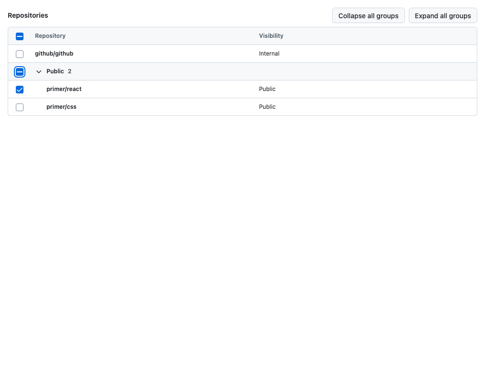
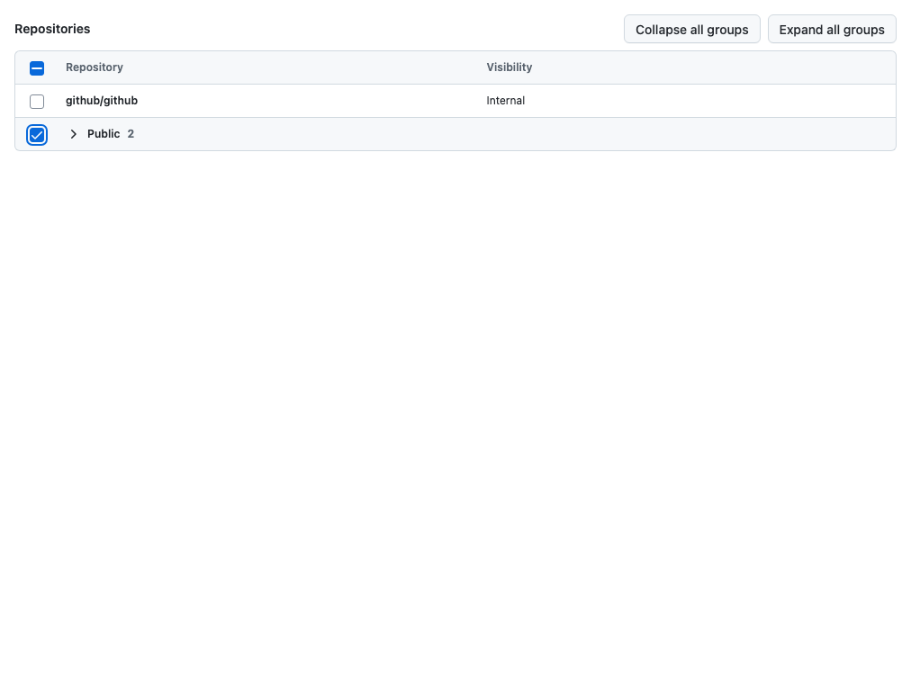
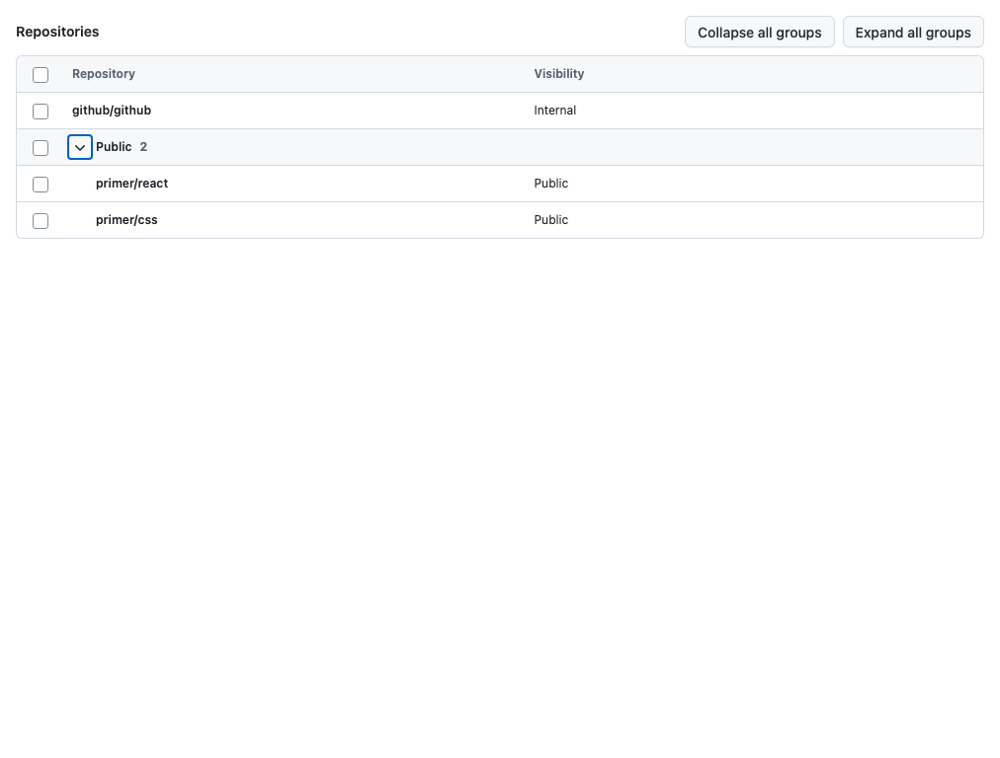

# DataTable group count and interaction evidence

Tracking: [#7345](https://github.com/github/primer/issues/7345) and
[#7346](https://github.com/github/primer/issues/7346).

The intentionally shipped checkbox plus disclosure model is retained. The checkbox
selects the group's selectable members, including collapsed members; the disclosure
independently controls visibility. This change associates the total member count
with both controls through one localized `aria-describedby` target. It does not
change their names, native checkbox semantics, or selection/expansion handlers.

## Matched rendered captures

Baseline: clean `f80b27cc531b4f12f3384a68a6c0259639d07d99`, captured **before any source edits**
on 2026-11-05 at 20:57:22 UTC. After: this PR's implementation, captured at 20:58:45 UTC.
Both captures used the unchanged `WithCollapsibleGroups` fixture in
[DataTable.features.stories.tsx](../../../packages/react/src/DataTable/DataTable.features.stories.tsx),
served from this isolated worktree on port 6007. The after capture's HEAD field
identifies the baseline commit; `sourceState` explicitly identifies the uncommitted
implementation captured at that time.

- Chromium 148.0.7778.96, macOS, 1012 × 768 CSS pixels, device scale factor 1.
- Light theme, normal/default cell padding, `en-US`, reduced motion.
- One standalone repository and two Public group members; `primer/react` initially selected.
- Same story, fixture, viewport, theme, density, and keyboard sequence for each pair.

All three before/after PNG pairs are byte-identical. These are actual browser
screenshots; the meaningful change is in the accessibility-tree description below.

| State and keyboard focus                        | Before                                                                                          | After                                                                                         |
| ----------------------------------------------- | ----------------------------------------------------------------------------------------------- | --------------------------------------------------------------------------------------------- |
| Mixed, expanded; group checkbox focused         |           |           |
| All selected, collapsed; group checkbox focused |         |         |
| None selected, expanded; disclosure focused     |  |  |

Reproduce the sequence after the story's play function completes:

1. Focus the Public disclosure and press Shift+Tab. Capture mixed/expanded.
2. Tab to the disclosure; Enter collapses. Shift+Tab to the checkbox; Space selects
   both members without expanding. Capture all/collapsed.
3. Space clears the group; Tab to disclosure; Space expands without selecting.
   Capture none/expanded with disclosure focus.

## Accessibility-tree evidence

The JSON records contain Chromium CDP `Accessibility.getFullAXTree` entries,
Playwright table trees, DOM properties, and focus state for every capture:
[before](./before-accessibility.json) · [after](./after-accessibility.json).

| Control                   | Before description              | After description                      | State in the three captures     |
| ------------------------- | ------------------------------- | -------------------------------------- | ------------------------------- |
| Checkbox, `Select Public` | None                            | `2 rows`                               | mixed → checked → unchecked     |
| Button, `Public`          | `2 rows` via `aria-description` | `2 rows` via shared `aria-describedby` | expanded → collapsed → expanded |

The checkbox has no expansion state; the disclosure has no checked state.
The group header remains named `Public`. Count text is supplemental description,
not part of either control's name and not a live region. These observations do
**not** establish spoken output, VoiceOver support, or accessibility sign-off.

The count means **all group members**, including non-selectable rows, matching the
visible count. It is not a selectable or selected-row total. Selection still
excludes non-selectable members. Consumers localize the description with
`DataTable.getGroupRowCountLabel` or `Table.Group.getRowCountLabel`; default English
is `0 rows`, `1 row`, or `N rows`.

## Automated verification

- Full Vitest run with `VITEST_FAIL_ON_CONSOLE=true npm test -- --run`:
  **163 files passed; 2,987 tests passed, 3 skipped, 10 todo**.
- Focused group tests cover singular/plural/zero counts, checked/mixed/unchecked,
  separate group references, localized descriptions, count updates while collapsed,
  stable checkbox identity/focus during a count change, keyboard ordering, selection
  of collapsed members, unselectable members, and disabled/empty groups.
- Existing expansion, selection, grouping, and SSR/hydration regressions are included.
- `npm run build`, `npm run type-check`, `npm run lint:fix` (which runs root lint),
  `npm run lint:css`, `npm run format`, and `npm run format:diff`: passed.
- `STORYBOOK_URL=http://localhost:6007 npx playwright test e2e/components/DataTable.test.ts --grep '@aat|@avt' --workers=2`:
  **157 passed; 4 failed only at screenshot matching because macOS baselines are absent**.
  Each of those four tests passed its preceding Axe check. Checked-in baselines are Linux.
- Additional focused Axe with the repository's `@github/axe-github` configuration:
  expanded/collapsed in light/dark all had **0 violations and 0 incomplete results**;
  [machine-readable results](./axe.json).
- Matched before/after visual comparison: all three PNG pairs byte-identical.

The first targeted run found a new test fixture with identical group/member names;
that query was corrected. A Storybook query used an unsupported `exact` option;
type checking caught it and it was removed. An initial full test run overlapped
with type checking's clean build and could not load generated package files; the
full run above passed after builds completed. No failures were suppressed.

The default npm registry endpoint was unavailable. Locked dependencies installed
successfully with `npm ci --registry=https://registry.npmjs.com --prefer-offline
--fetch-retries=0 --no-audit --no-fund`; package and lock files are unchanged.

## Focused accessibility review and remaining checks

Reviewed the count association and directly affected native checkbox/button,
header structure, keyboard ordering, and expansion behavior. The review applied
the accessibility-review skill's common policy, the full WCAG A/AA discovery
index, relevant detailed criteria and GitHub interpretations (1.3.1, 1.3.2,
2.1.1, 2.1.2, 2.4.3, 2.4.6, 2.4.7, 2.4.11, 2.5.3, 3.2.1, 3.2.2, 3.3.2, 4.1.2),
form/keyboard/native-semantics checks, local Primer source, and
[Primer's DataTable accessibility guidance](https://primer.style/product/components/data-table/accessibility/).
No new barrier was demonstrated by the inspected source or automated checks.
Unchanged media, motion, authentication, pointer gestures, and page navigation
were outside this change. Styling and geometry are unchanged in the matched captures.

[The historical audit](https://github.com/github/accessibility/issues/10807#issuecomment-4845725068)
reviewed a different group-control model and allowed exploration of both controls.
It neither establishes a failure nor signs off this combination. The assigned
issue source and handoff links were read. A search of `github/accessibility-audits`
for `DataTable group` with the accessibility label returned no additional matches.

The review guidance flags custom disclosure patterns for focused human review.
That remains a **caution**, not a demonstrated WCAG failure or a reason to remove
the intentional group checkbox. Native disabled behavior is retained, including
the already-shipped missing-callback fix. The localization and description change
adds no custom keyboard or focus behavior.

[Published `aria-describedby` support evidence](https://a11ysupport.io/tech/aria/aria-describedby_attribute)
reports support for the ordinary input-description test across the requested
screen readers; its partial VoiceOver aggregate includes a separate alert-role
test. That older evidence does not test this checkbox/disclosure combination or
prove current spoken behavior. Description changes while focused particularly
need manual verification.

**Manual AT testing has not been run. Both issues remain open for focused review.**

| Browser and screen reader | Status  |
| ------------------------- | ------- |
| NVDA + Firefox            | Pending |
| JAWS + Chrome or Edge     | Pending |
| VoiceOver + Safari        | Pending |

For each combination, verify by both Tab navigation and screen-reader table/form
navigation:

- The group checkbox is announced with its concise name, total-row description,
  and checked/mixed/unchecked or disabled state; disclosure announces its own
  name, count, and expanded/collapsed state separately.
- Tab and Shift+Tab move between checkbox and disclosure in that order; Space
  on the checkbox only changes selection; Enter/Space on the disclosure only
  changes expansion; focus remains on the activated control.
- Select and clear while collapsed, including a group containing unselectable
  members; expand and confirm only selectable members changed.
- Empty and entirely unselectable groups expose a disabled checkbox while the
  disclosure remains operable; disabled checkboxes are skipped by native Tab order.
- Check 0/1/many and localized counts, and changing counts while focused and while
  collapsed. Confirm whether the updated description is spoken immediately or on
  refocus; do not infer a live announcement from a changed accessibility tree.
- Collapse externally while a member is focused and confirm return to the group's
  disclosure. Check header association and absence of confusing duplicate count
  speech during table navigation.
